<p align="center">
  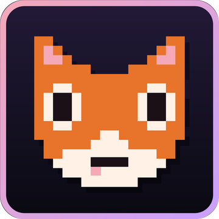
</p>

<h1 align="center">
  <picture>
    <source media="(prefers-color-scheme: dark)" srcset="assets/wordmark-dark.png">
    <source media="(prefers-color-scheme: light)" srcset="assets/wordmark-light.png">
    
  </picture>
</h1>

<p align="center">
  <b>A rhythm game for Friday Night Funkin' and Clone Hero songs.</b><br>
  Play it as a desktop app or inside Minecraft, and play together online.
</p>

<p align="center">
  <a href="https://github.com/CypressFox/Foxtrot/releases/latest"></a>
  <a href="https://github.com/CypressFox/Foxtrot/releases"></a>
  
  
</p>

<p align="center">
  <a href="https://github.com/CypressFox/Foxtrot/releases/latest"></a>
  <a href="https://github.com/CypressFox/Foxtrot/releases/latest">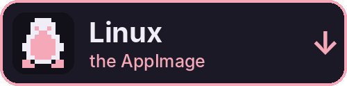</a>
  <br>
  <a href="https://github.com/CypressFox/Foxtrot/releases/latest">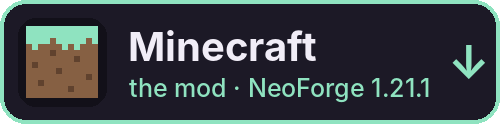</a>
  <a href="https://github.com/CypressFox/Foxtrot/releases/latest">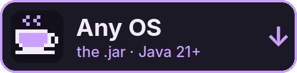</a>
</p>

<p align="center"><sub>Every button opens the newest release. Under <b>Assets</b>, pick the one file for you (<a href="#which-file">which file?</a>).</sub></p>

<p align="center">
  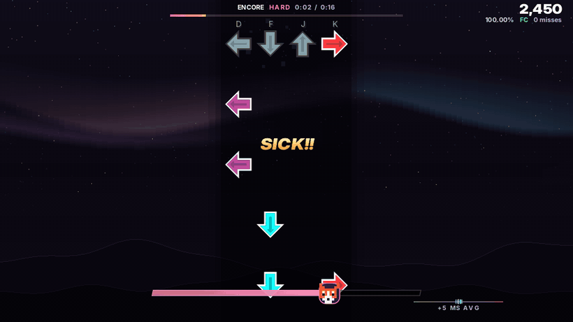
</p>

<p align="center"><sub>No install? Try a quick song right in your browser at <a href="https://foxtrotgame.uk/play">foxtrotgame.uk/play</a>.</sub></p>

## New in 5.0: Season 2 · The Encore Tour

The biggest FoxTrot update yet, so it gets a whole new number. Every screen has been rebuilt as a concert stage, Ranked and pp are here, and Season 2 comes with a 50-level tour to play through. The first time 5.0 starts, a short intro shows you what's new, then a guided tour shows you where everything is.

<table>
  <tr>
    <td width="50%" valign="top">
      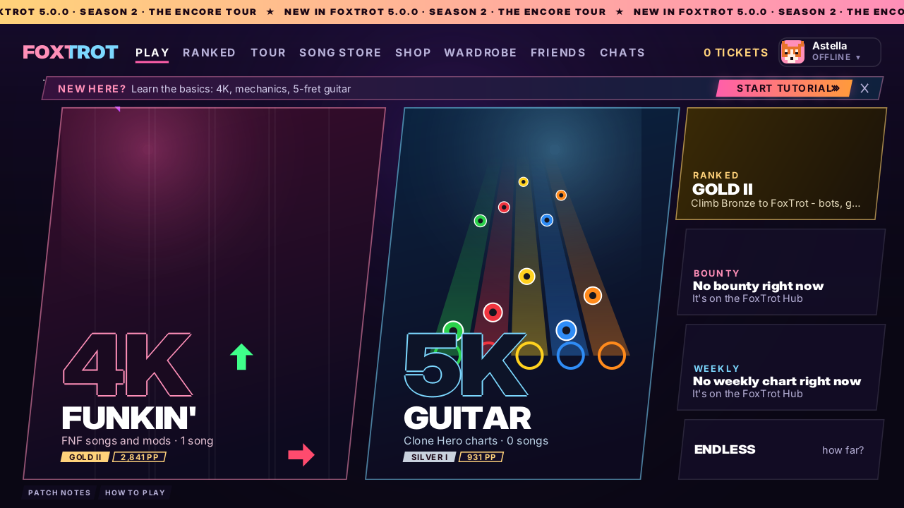<br>
      <b>The Encore look</b><br>
      Every screen rebuilt as a concert stage, with stage lights and a floor that moves on the beat. There's a new menu theme too, made from scratch for FoxTrot.
    </td>
    <td width="50%" valign="top">
      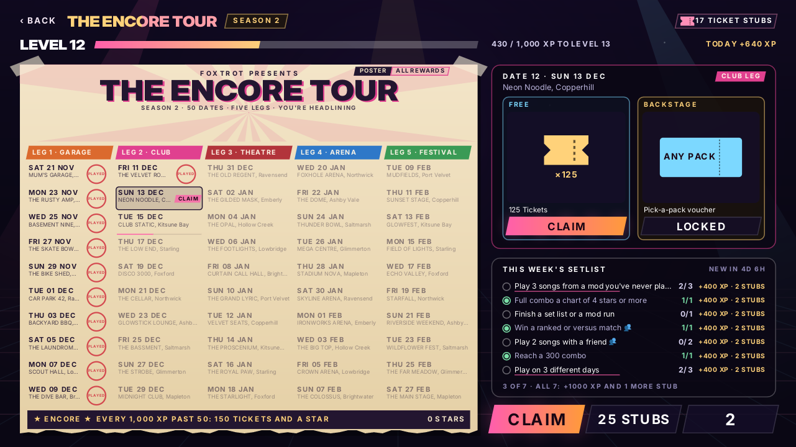<br>
      <b>The Encore Tour</b><br>
      Season 2's pass: 50 levels, each one a date on a tour poster. The Free track is for everyone. Backstage costs Ticket Stubs, which you earn from weekly challenges and never buy with money.
    </td>
  </tr>
  <tr>
    <td width="50%" valign="top">
      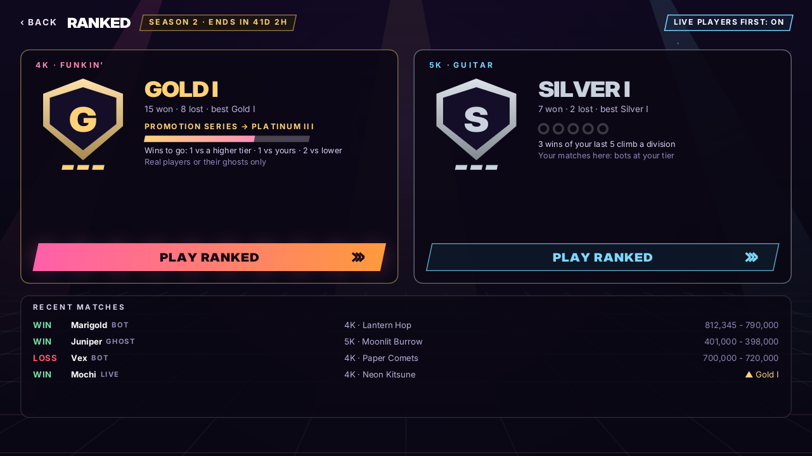<br>
      <b>Ranked</b><br>
      4K and 5K each have their own ladder, from Bronze up to FoxTrot. Climb through division matches against bots at your tier, then win a promotion series against real players or their recorded runs.
    </td>
    <td width="50%" valign="top">
      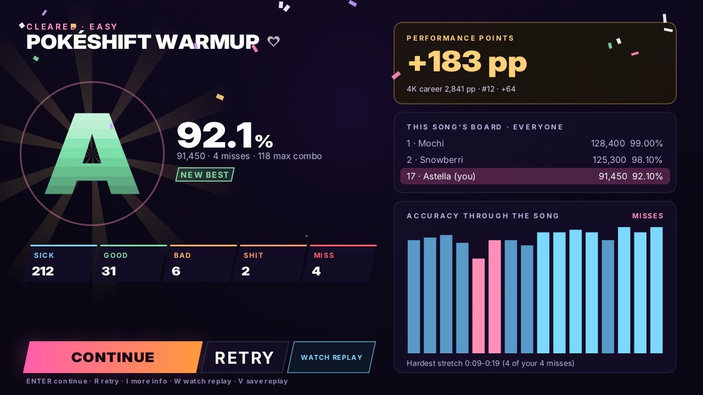<br>
      <b>pp and star ratings</b><br>
      Every chart gets a star rating, and every ranked play is worth pp. Harder charts and better accuracy are worth more, and your career pp adds up your best plays, so the way up is getting better at hard songs.
    </td>
  </tr>
  <tr>
    <td width="50%" valign="top">
      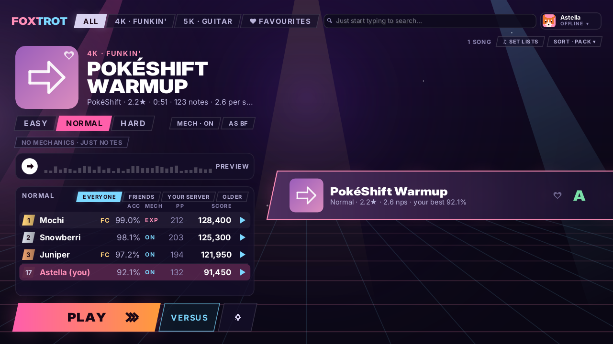<br>
      <b>A new song select</b><br>
      Tabs for 4K, 5K and your ♥ favourites, star ratings, and the leaderboard right under the preview: Everyone, Friends, Your server. Press ▶ on any run to watch its replay.
    </td>
    <td width="50%" valign="top">
      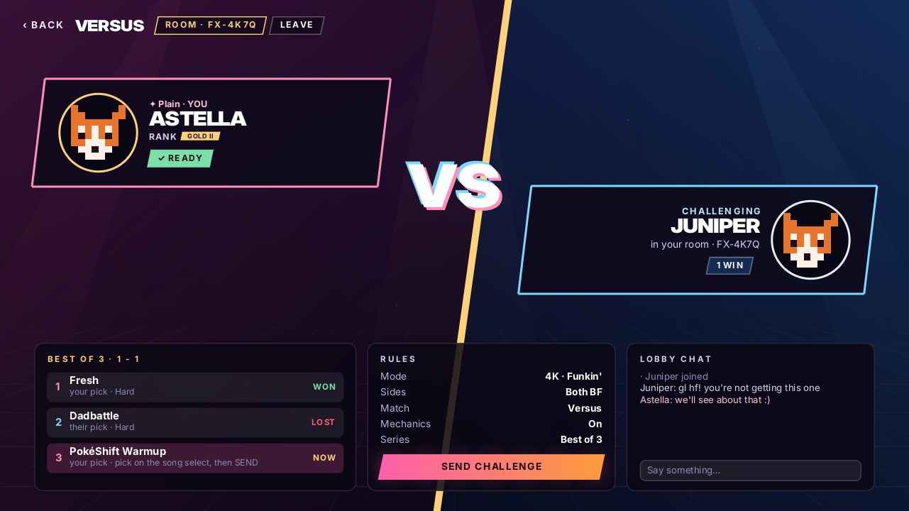<br>
      <b>Versus rooms</b><br>
      Make a room, share its code, chat in the lobby and play a best of 3. Set lists let you build your own run of up to 50 songs and share it with a short code.
    </td>
  </tr>
</table>

<p align="center"><sub>Also new: separate 4K and 5K careers, nine new mods with their own stages (and a new one every fortnight), replays you can export as video, boosters and Double XP weekends, and quick signed hotfixes. Season 1's boards are archived, and everyone on its final board got a Season 1 badge. The <a href="https://github.com/CypressFox/Foxtrot/releases/tag/v5.0.0">5.0.0 release</a> has the full patch notes.</sub></p>

## What is FoxTrot?

FoxTrot is a full rhythm game. Hit the notes as they reach the line, keep your combo going and climb the boards.

- **FNF and Clone Hero, side by side.** Four-lane Friday Night Funkin' songs with the opponent singing back, and five-fret Clone Hero / YARG guitar songs with Star Power and sustains.
- **App, Minecraft or browser.** The desktop app runs on its own on Windows and Linux. The mod puts the same game inside Minecraft. Both play together online through the FoxTrot Hub at [foxtrotgame.uk](https://foxtrotgame.uk): shared leaderboards, versus, friends and chats. You can also try a quick song in your browser.
- **Seasons to climb.** Ranked ladders and pp for 4K and 5K, the Encore Tour's 50 levels, and careers and boards that start fresh each season.
- **Runs to chase.** The Weekly's new set of songs every week, Endless (random songs back to back until you fail), and set lists you build and share.
- **Song mechanics from FNF mods**, with a level for every taste: Off, Relaxed, On or Expert.
- **Free to play.** Cosmetics, packs and the tour's Backstage come from Tickets and Ticket Stubs, which you earn by playing. Nothing in FoxTrot is ever bought with real money.

## Features

<table>
  <tr>
    <td width="50%" valign="top">
      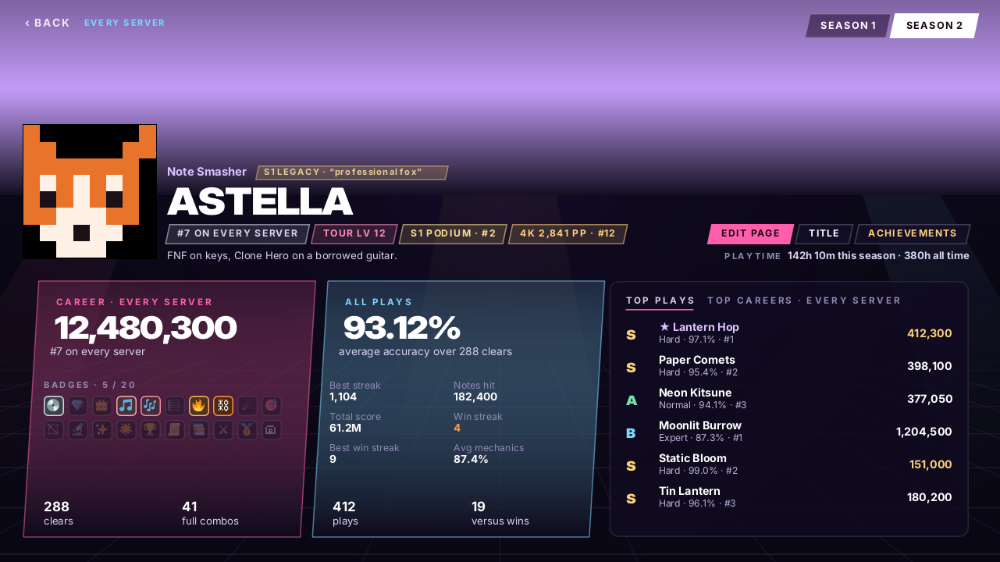<br>
      <b>Your career</b><br>
      Career score, pp, rank and playtime for 4K and 5K, your badges and top plays. Season 1's career stays on as a tab.
    </td>
    <td width="50%" valign="top">
      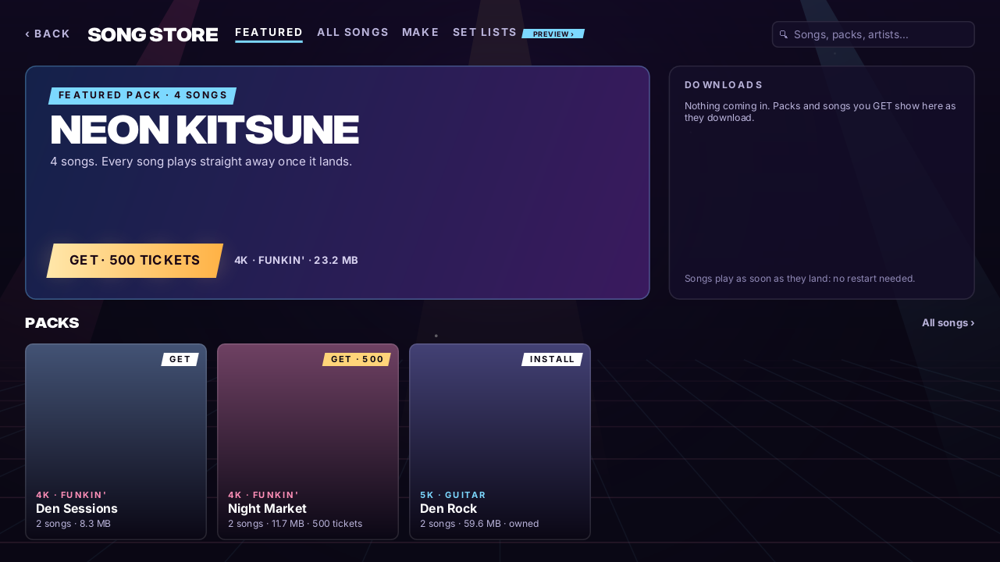<br>
      <b>The Song Store</b><br>
      Pick a pack and it downloads, with mod stages that come in by themselves. Publish your own charts there from the Make tab.
    </td>
  </tr>
  <tr>
    <td width="50%" valign="top">
      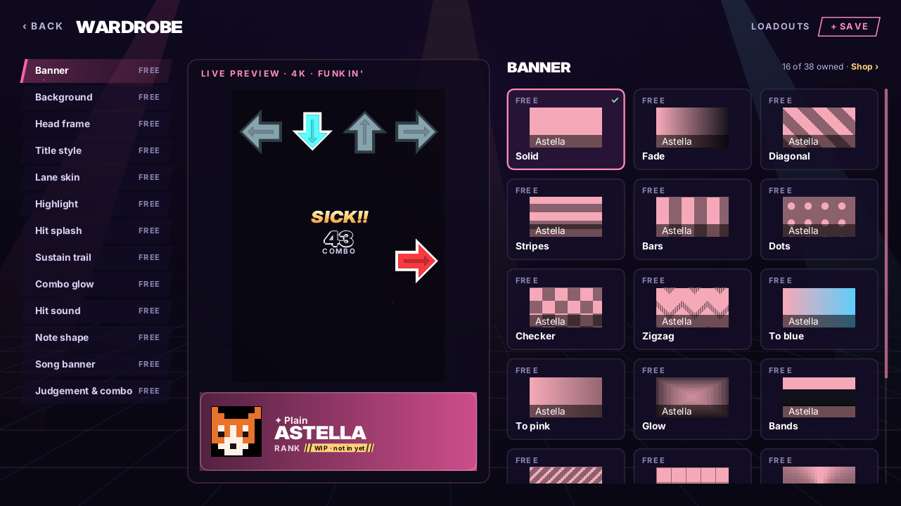<br>
      <b>Make it yours</b><br>
      Lane skins, note shapes, hit splashes, banners, titles and more in the Wardrobe, with up to 5 saved outfits.
    </td>
    <td width="50%" valign="top">
      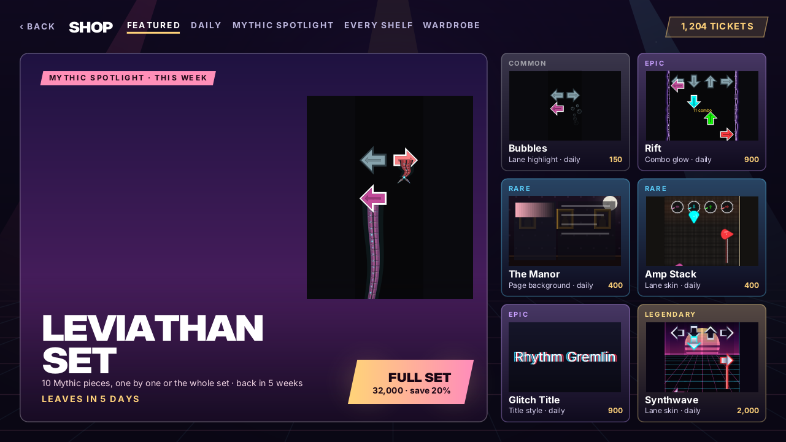<br>
      <b>The Shop</b><br>
      New cosmetics every day and a Mythic set in the spotlight every week, all for Tickets you win by playing.
    </td>
  </tr>
</table>

<p align="center"><sub>Also in the box: a full chart maker with auto-charting and mechanics, voice calls and screen sharing in the chats, the Weekly and Endless, an offset finder that listens to you tap, patch notes in the game, and Discord activity.</sub></p>

## Install

<a id="which-file"></a>
Open the [newest release](https://github.com/CypressFox/Foxtrot/releases/latest), then **Assets**, and download one file:

| You play on | Download | Notes |
|---|---|---|
| **Windows** | `FoxTrot-<version>-windows-x64-setup.exe` | Java is included |
| **Linux** | `FoxTrot-<version>-x86_64.AppImage` | Java is included; runs on any 64-bit distro |
| **Minecraft** | `foxtrot-<version>.jar` + [SnowberriLib](https://github.com/CypressFox/SnowberriLib/releases/latest) | NeoForge for Minecraft 1.21.1 |
| **Anything else with Java 21+** | `foxtrot-app-<version>.jar` | The desktop app as one jar |

<details>
<summary><b>🪟 Windows</b></summary>

1. Run `FoxTrot-<version>-windows-x64-setup.exe`.
2. The installer isn't signed, so Windows SmartScreen may stop it. Click **More info**, then **Run anyway**.
3. FoxTrot is in your Start menu. The app tells you when there's a new version.

</details>

<details>
<summary><b>🐧 Linux</b></summary>

1. Download `FoxTrot-<version>-x86_64.AppImage`.
2. Let it run: right-click it, **Properties**, then tick **Allow executing file as program**. Or in a terminal:
   ```sh
   chmod +x FoxTrot-*-x86_64.AppImage
   ```
3. Double-click it. [Gear Lever](https://flathub.org/apps/it.mijorus.gearlever) (or another AppImage manager) can keep it up to date.

</details>

<details>
<summary><b>⛏️ Minecraft</b></summary>

1. Install [NeoForge](https://neoforged.net/) for Minecraft **1.21.1**.
2. Put **both** of these in your `mods` folder:
   - `foxtrot-<version>.jar` from this repo's releases
   - `snowberrilib-<version>.jar` from [SnowberriLib](https://github.com/CypressFox/SnowberriLib/releases/latest) (FoxTrot needs it)
3. Start the game. On a server, the server needs FoxTrot too.

</details>

<details>
<summary><b>☕ Any OS with Java</b></summary>

With Java 21 or newer installed:

```sh
java -jar foxtrot-app-<version>.jar
```

</details>

## Adding songs

- **From the hub:** in the app, **Get songs** opens the Song Store. Pick a song and it downloads.
- **Clone Hero / YARG songs:** on the song select's **Clone Hero** tab, press **+ Import** and pick your songs folder. They stay where they are.
- **FNF songs:** drop each song's folder (its chart `.json` files and its music) into FoxTrot's `songs` folder:

  | | Songs folder |
  |---|---|
  | App on Linux | `~/.local/share/FoxTrot/songs` |
  | App on Windows | `%APPDATA%\FoxTrot\songs` |
  | Minecraft | `config/foxtrot/songs` in your game folder |

  Then type `/foxtrot reload` in Minecraft, or restart the app.

## Older versions

Every release from FoxTrot 4.5.5 on is on this repo’s [releases page](https://github.com/CypressFox/Foxtrot/releases). Releases up to FoxTrot 4.5.4 are in [Pokeshift-updates](https://github.com/SnowberriFox/Pokeshift-updates/releases).

---

<sub><b>For maintainers:</b> <code>update.json</code> is what the game reads to tell players there's a newer build (a toast on the title screen, the app’s <b>Update now</b>, and a chat line with a link when they join in Minecraft). <code>promos."1.21.1-latest"</code> is the newest build, early access included (early-access players hear about it). <code>promos."1.21.1-recommended"</code> is the newest stable build (everyone hears about it). <code>"1.21.1"</code> has a one-line note per version, shown with the notice. <code>promos."app-recommended"</code> (since 4.6.5) is the desktop app's own line: the newest app build, which the app offers (<b>Update now</b> on Windows). Only the app reads it, so bump it for every release that has an app build, app-only ones included; for an app-only release leave the <code>1.21.1</code> lines where the mod is (servers' SnowberriLib updater looks for <code>foxtrot-&lt;version&gt;.jar</code> when those move). Apps before 4.6.5 still go by <code>1.21.1-recommended</code>. <code>promos."app-nightly"</code> (since 4.7.4) is the nightly (early access) app build, offered only to players with Settings → Updates → Nightly, and only when it’s newer than <code>app-recommended</code>: point it at the stable version once a release is out. <code>"app"</code> has a one-line note per app version (one not in it uses its <code>"1.21.1"</code> note). Keep this repo public so the game can read it. The code lives in a private repo.</sub>
