<p align="center">
  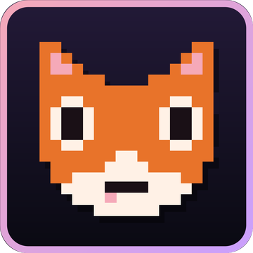
</p>

<h1 align="center">
  <picture>
    <source media="(prefers-color-scheme: dark)" srcset="assets/wordmark-dark.png">
    <source media="(prefers-color-scheme: light)" srcset="assets/wordmark-light.png">
    
  </picture>
</h1>

<p align="center">
  <b>A rhythm game for Friday Night Funkin' and Clone Hero songs.</b><br>
  Play it as a desktop app or inside Minecraft, and play together online.
</p>

<p align="center">
  <a href="https://github.com/SnowberriFox/Foxtrot-Updates/releases/latest"></a>
  <a href="https://github.com/SnowberriFox/Foxtrot-Updates/releases"></a>
  
  
</p>

<p align="center">
  <a href="https://github.com/SnowberriFox/Foxtrot-Updates/releases/latest"></a>
  <a href="https://github.com/SnowberriFox/Foxtrot-Updates/releases/latest">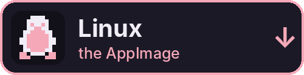</a>
  <br>
  <a href="https://github.com/SnowberriFox/Foxtrot-Updates/releases/latest">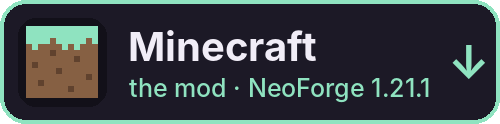</a>
  <a href="https://github.com/SnowberriFox/Foxtrot-Updates/releases/latest">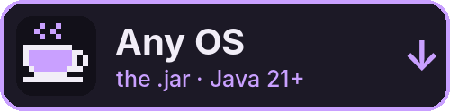</a>
</p>

<p align="center"><sub>Every button opens the newest release. Under <b>Assets</b>, pick the one file for you (<a href="#which-file">which file?</a>).</sub></p>

<p align="center">
  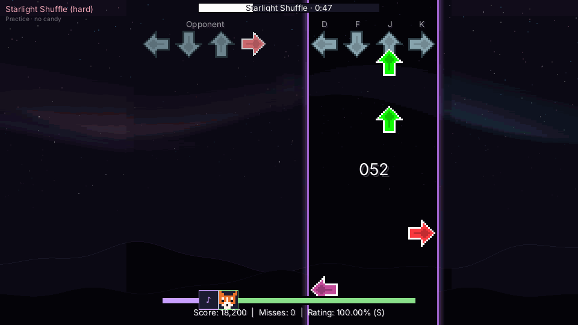
</p>

## What is FoxTrot?

FoxTrot is a full rhythm game. Hit the notes as they reach the line, keep your combo going and climb the boards.

- **FNF and Clone Hero, side by side.** Four-lane Friday Night Funkin' songs with the opponent singing back, and five-fret Clone Hero / YARG guitar songs with Star Power and sustains.
- **App or Minecraft, your pick.** The desktop app runs on its own on Windows and Linux. The mod puts the same game inside Minecraft. Both play together online through the FoxTrot Hub: shared leaderboards, versus, friends and chats.
- **Song mechanics from FNF mods**, with a level for every taste: Off, Relaxed, On or Expert.
- **Free to play.** Cosmetics come from the shop for Tickets, which you win by playing.

## Features

<table>
  <tr>
    <td width="50%" valign="top">
      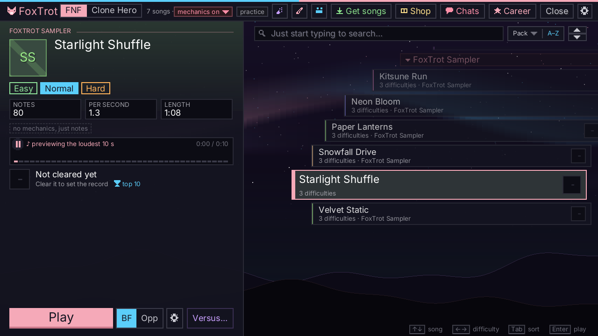<br>
      <b>Every song in one list</b><br>
      Packs, search and sorting, and a preview of the song you're on. You can pause it with Space.
    </td>
    <td width="50%" valign="top">
      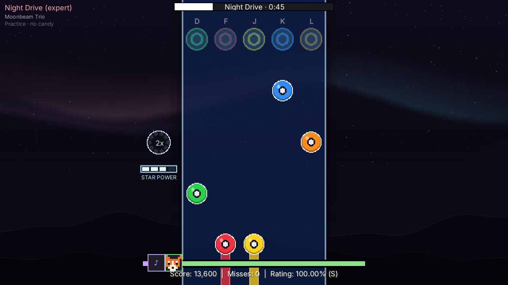<br>
      <b>Five-fret guitar</b><br>
      Clone Hero charts with Star Power, chords, sustains and the multiplier. Bring your Clone Hero or YARG songs folder.
    </td>
  </tr>
  <tr>
    <td width="50%" valign="top">
      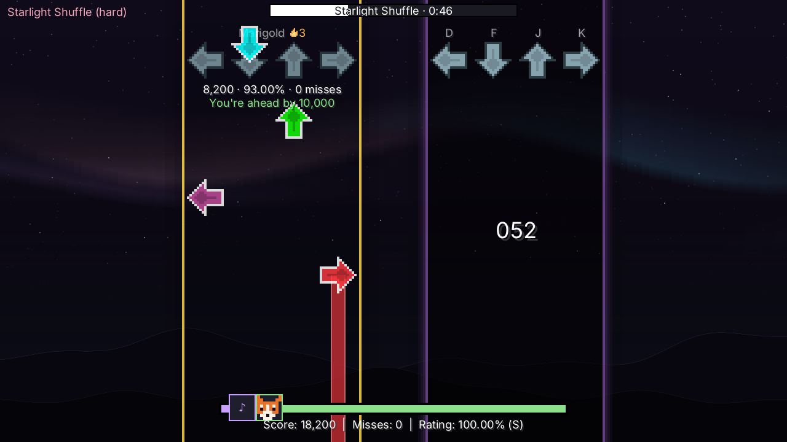<br>
      <b>Versus your friends</b><br>
      Play the same song live and watch the gap. Win streaks, free-for-alls and spectating too.
    </td>
    <td width="50%" valign="top">
      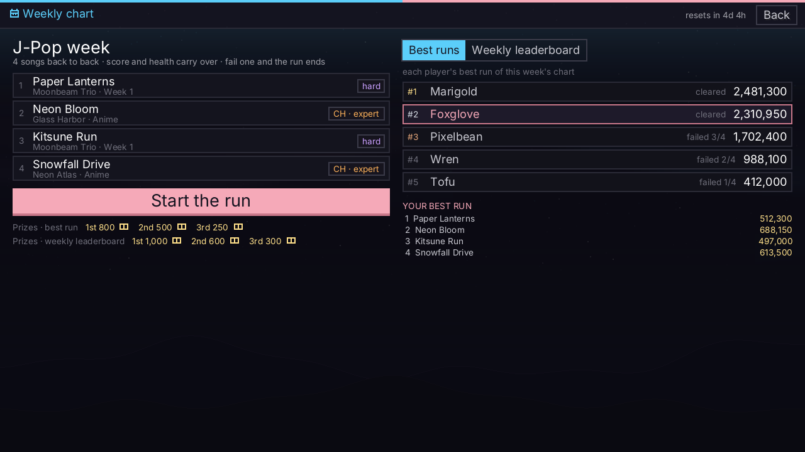<br>
      <b>The Weekly</b><br>
      A new set of songs every week, back to back. Score and health carry over, and the top three win Tickets.
    </td>
  </tr>
  <tr>
    <td width="50%" valign="top">
      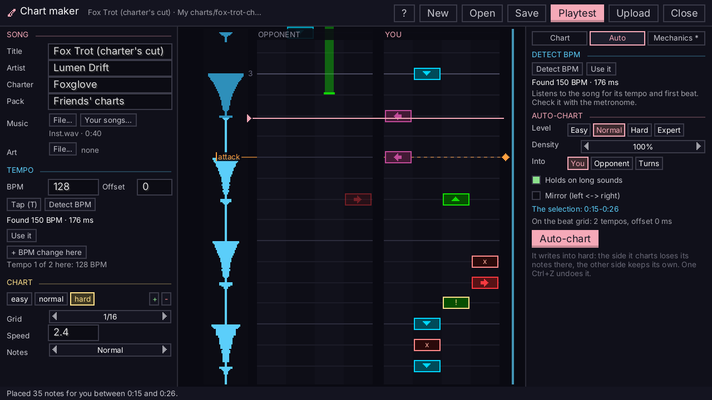<br>
      <b>Make your own charts</b><br>
      A full chart maker with a waveform and playtest. The Auto tab finds the BPM and charts a stretch for you.
    </td>
    <td width="50%" valign="top">
      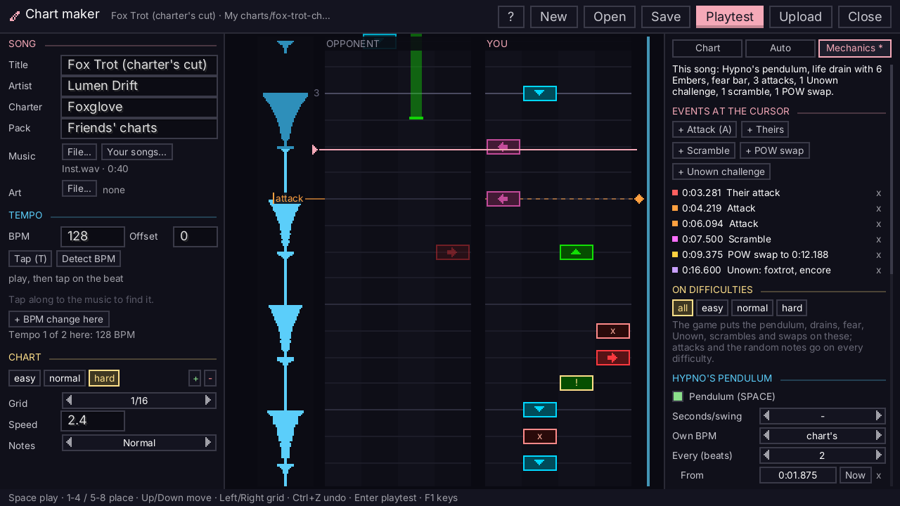<br>
      <b>…with mechanics</b><br>
      New in 4.5.5: add attacks, scrambles, swaps, drains and more right in the editor, then share it to the hub.
    </td>
  </tr>
  <tr>
    <td width="50%" valign="top">
      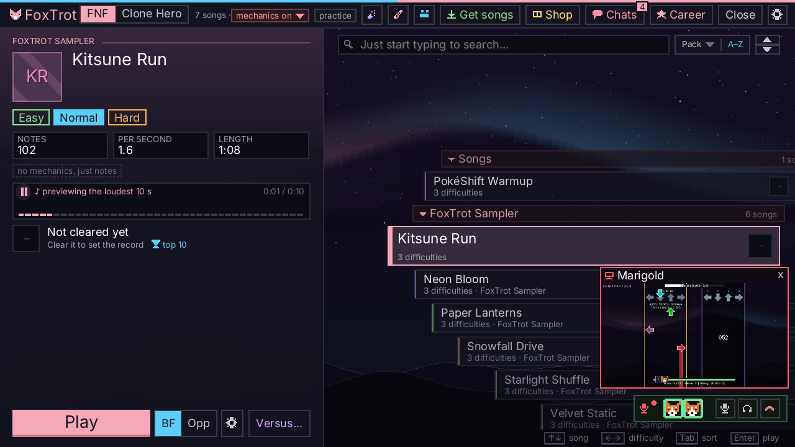<br>
      <b>Voice calls and screen sharing</b><br>
      Call your friends from the app's chats and watch each other play, game sound included.
    </td>
    <td width="50%" valign="top">
      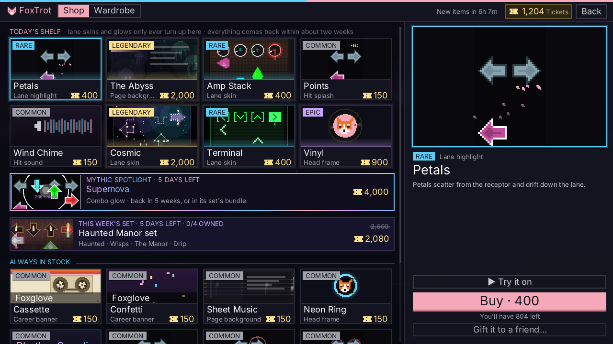<br>
      <b>Make it yours</b><br>
      Lane skins, hit splashes, combo glows, hit sounds and profile looks, all for Tickets you earn.
    </td>
  </tr>
  <tr>
    <td colspan="2" valign="top">
      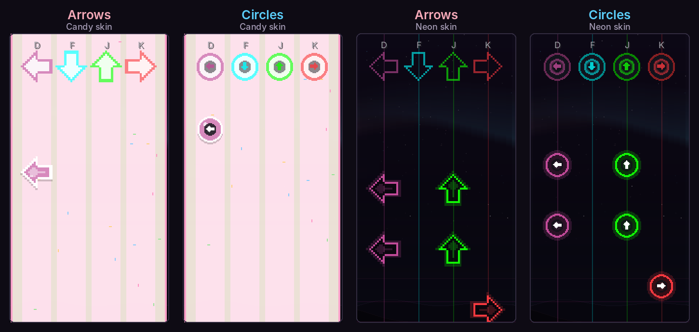<br>
      <b>Arrows or circles, on any skin</b><br>
      Pick your note shape in the Lane studio. Circles keep each lane's colour with a small arrow inside.
    </td>
  </tr>
</table>

<p align="center"><sub>Also in the box: an offset finder that listens to you tap, career pages and badges, patch notes in the game, and Discord activity.</sub></p>

## Install

<a id="which-file"></a>
Open the [newest release](https://github.com/SnowberriFox/Foxtrot-Updates/releases/latest), then **Assets**, and download one file:

| You play on | Download | Notes |
|---|---|---|
| **Windows** | `FoxTrot-<version>-windows-x64-setup.exe` | Java is included |
| **Linux** | `FoxTrot-<version>-x86_64.AppImage` | Java is included; runs on any 64-bit distro |
| **Minecraft** | `foxtrot-<version>.jar` + [SnowberriLib](https://github.com/SnowberriFox/SnowberriLib-Updates/releases/latest) | NeoForge for Minecraft 1.21.1 |
| **Anything else with Java 21+** | `foxtrot-app-<version>.jar` | The desktop app as one jar |

<details>
<summary><b>🪟 Windows</b></summary>

1. Run `FoxTrot-<version>-windows-x64-setup.exe`.
2. The installer isn't signed, so Windows SmartScreen may stop it. Click **More info**, then **Run anyway**.
3. FoxTrot is in your Start menu. The app tells you when there's a new version.

</details>

<details>
<summary><b>🐧 Linux</b></summary>

1. Download `FoxTrot-<version>-x86_64.AppImage`.
2. Let it run: right-click it, **Properties**, then tick **Allow executing file as program**. Or in a terminal:
   ```sh
   chmod +x FoxTrot-*-x86_64.AppImage
   ```
3. Double-click it. [Gear Lever](https://flathub.org/apps/it.mijorus.gearlever) (or another AppImage manager) can keep it up to date.

</details>

<details>
<summary><b>⛏️ Minecraft</b></summary>

1. Install [NeoForge](https://neoforged.net/) for Minecraft **1.21.1**.
2. Put **both** of these in your `mods` folder:
   - `foxtrot-<version>.jar` from this repo's releases
   - `snowberrilib-<version>.jar` from [SnowberriLib-Updates](https://github.com/SnowberriFox/SnowberriLib-Updates/releases/latest) (FoxTrot needs it)
3. Start the game. On a server, the server needs FoxTrot too.

</details>

<details>
<summary><b>☕ Any OS with Java</b></summary>

With Java 21 or newer installed:

```sh
java -jar foxtrot-app-<version>.jar
```

</details>

## Adding songs

- **From the hub:** in the app, **Get songs** opens the Song Store. Pick a song and it downloads.
- **Clone Hero / YARG songs:** on the song select's **Clone Hero** tab, press **+ Import** and pick your songs folder. They stay where they are.
- **FNF songs:** drop each song's folder (its chart `.json` files and its music) into FoxTrot's `songs` folder:

  | | Songs folder |
  |---|---|
  | App on Linux | `~/.local/share/FoxTrot/songs` |
  | App on Windows | `%APPDATA%\FoxTrot\songs` |
  | Minecraft | `config/foxtrot/songs` in your game folder |

  Then type `/foxtrot reload` in Minecraft, or restart the app.

## Older versions

Releases up to FoxTrot 4.5.4 are in [Pokeshift-updates](https://github.com/SnowberriFox/Pokeshift-updates/releases).

---

<sub><b>For maintainers:</b> <code>update.json</code> is what the game reads to tell players there's a newer build (a toast on the title screen, and a chat line with a link when they join). <code>promos."1.21.1-latest"</code> is the newest build, early access included (early-access players hear about it). <code>promos."1.21.1-recommended"</code> is the newest stable build (everyone hears about it). <code>"1.21.1"</code> has a one-line note per version, shown with the notice. Keep this repo public so the game can read it. The code lives in a private repo.</sub>
